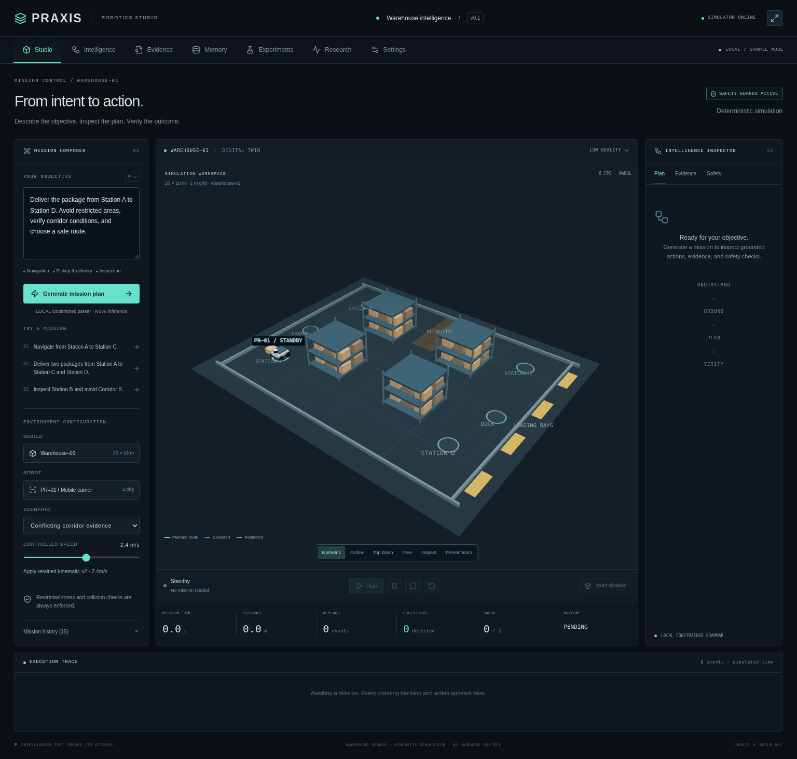

# PRAXIS
### Intelligence that proves its actions.

A working browser-based robotics studio with a deterministic warehouse simulator, constrained natural-language task interpretation, A* navigation, pickup and delivery, evidence reconciliation, verified persistent memory, and reproducible controller experiments.

**Status: local/sample demonstration. Sponsor acceptance remains blocked.** This release does not perform AI inference or call Zetaris, Nightshift, NVIDIA Nemotron, or a Meterless Engine. The Settings workspace reports these as `UNAVAILABLE`; synthetic operational records are always labeled `SAMPLE`. This is not a complete hackathon submission or a production deployment.



## Start

Tested with Python **3.12.14**, Node **24.19.0**, npm **11.9.0**, and Linux. Python 3.11+ and a modern Node release supported by Vite are required. Use the existing checkout; cloud tasks are already isolated and do not require worktrees.

```bash
cd /workspace/Gen---AI-Hackathon
./scripts/install.sh
./scripts/start.sh
```

The frontend listens on port 5173 and proxies `/api` and WebSocket traffic to the backend on port 8000. Use the hosting platform's supported access mechanism. The onboarding interface does not provide localhost previews.

To run the processes individually, in separate terminals:

```bash
cd /workspace/Gen---AI-Hackathon/backend
/workspace/praxis-venv/bin/python -m uvicorn app.main:app --host 127.0.0.1 --port 8000 --timeout-graceful-shutdown 2
```

```bash
cd /workspace/Gen---AI-Hackathon/frontend
npm run dev -- --port 5173 --strictPort
```

`PRAXIS_VENV` overrides the virtualenv path used by scripts. `DATABASE_URL` overrides SQLite persistence (default `/workspace/praxis-data/praxis.db`). Create the parent directory if changing that location. Environment variables are read from the process; `.env` files are not loaded automatically. No credentials are needed for local mode.

## Mission workflow

1. Enter a supported prompt and select a scenario and speed.
2. Generate the plan. Inspect grounded actions, constraints, route preview and source labels.
3. Click **Run** to authorize simulation. Pause, resume, emergency stop, reset, or insert an obstacle on the remaining route.
4. Inspect the actual execution trace and verification. Only verified outcomes are retained as trusted memory.
5. Open Experiments to compare controllers on matched tasks; export results or replay recorded cell traces.

Supported examples:

```text
Navigate from Station A to Station B.
Navigate to Station C.
Deliver the package from Station A to Station D. Avoid restricted areas, verify corridor conditions, and choose a safe route.
Pick up two packages at Station C.
Deliver two packages from Station C to Station D and loading dock.
Inspect Station B and avoid Corridor B.
```

Exact local commands in the composer also support `Explain why the robot changed direction.`, `Explain this mission.`, `Compare controllers.`, `Run experiments.`, and `Place an obstacle in front of the robot.` Experiments invoked this way use the displayed default protocol: seed 42, five trials per policy, unexpected-obstacle scenario. The laboratory exposes configurable trials, seed and scenario.

The local parser is a **limited grammar, not an LLM**. It rejects unknown words, locations, unsupported capabilities, ambiguous ordering and negation rather than silently executing a fallback task. Each mission starts at A with a fresh scenario and two fixture packages at each non-charging station. Unspecified delivery sources default to A and are visible in the preview. Multiple deliveries support at most two destinations. Stations: A, B, C, D, loading dock, charging station. All missions enforce restricted cells; the restricted scenario is the same guarded warehouse, while the explicit `avoid Corridor B` constraint adds that corridor to forbidden cells.

## Workspaces

- **Studio:** mission composer, state-driven React Three Fiber warehouse, six cameras, route overlays, cargo, controls, timeline and metrics.
- **Intelligence:** structured actions and decision summaries; no private model reasoning is claimed.
- **Evidence:** source timestamps, provenance, conflicts, selected records and conservative resolutions.
- **Memory:** SQLite-backed verified outcomes, 24-hour reuse window, current-state revalidation and manual invalidation.
- **Experiments:** static, reactive, PRAXIS and candidate-speed controllers; seeded trials, retained parameter candidates, JSON export and cell-trace replay. Retained speed settings can be applied in Studio.
- **Research:** explicit evaluation scope and pinned ASPIRE source reference.
- **Settings:** truthful provider configuration-presence diagnostics. Presence alone never means a connection works.

## Verify

```bash
./scripts/check.sh                      # pytest, Vitest, TypeScript and production build
# With both services running:
cd frontend && npm run test:e2e          # real Chromium / WebGL browser tests
```

The browser tests use `/usr/bin/chromium` when installed, otherwise Playwright's installed Chromium. Override with `CHROMIUM_PATH`. For a machine without Chromium, run `npx playwright install --with-deps chromium` from `frontend` with package-network/system access. Browser tests modify local simulation/history records; use a separate `DATABASE_URL` when isolating runs. Screenshots and traces are ignored under `frontend/test-results/`.

```bash
cd /workspace/Gen---AI-Hackathon
PYTHONPATH=backend /workspace/praxis-venv/bin/python scripts/benchmark.py
```

This writes six measured experiment datasets to `experiments/`; timings reflect the current machine. See [validation](docs/validation.md), [architecture](docs/architecture.md), [research](docs/research.md), [integrations and blockers](docs/integrations.md), and [submission materials](docs/submission.md).

## Honest scope and remaining work

This is a single-operator **development application**, with a shared in-process mission and no authentication, tenancy, production hosting, rate limits or hardware control. Deploying publicly requires a separate security and operations pass. SQLite stores local mission outcomes, evidence and traces, not sponsor data. Active processes and in-progress missions do not survive restart; persisted terminal history, experiments and verified memory do.

Physics is a grid/kinematic abstraction, not MuJoCo, Isaac Sim or a rigid-body simulation. Stations have per-mission fixture inventory. Replanning conservatively returns the visual position to the last safe grid cell. Cargo transitions have dwell time; there is no modeled manipulator. Trace replay runs recorded cell positions at 8 cells/s, not original wall-clock timing. Initial sensor occupancy is globally visible to PRAXIS; there is no noisy/occluded lidar model. No learning or performance superiority over ASPIRE is established.

Required next milestone: obtain official sponsor documentation, reachable endpoints and secure credentials; implement documented adapters, validate real queries/inference/Engine behavior, and record evidence before marking any integration live. Verify official hackathon rules and deadline, record a real demo, and publish/submit only after these gates. See the precise continuation checklist in `docs/integrations.md`.
